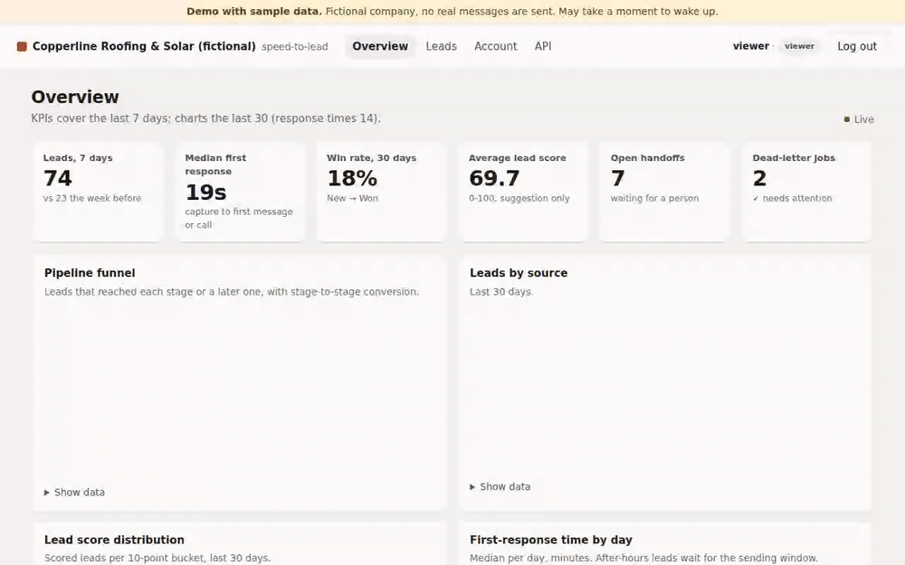
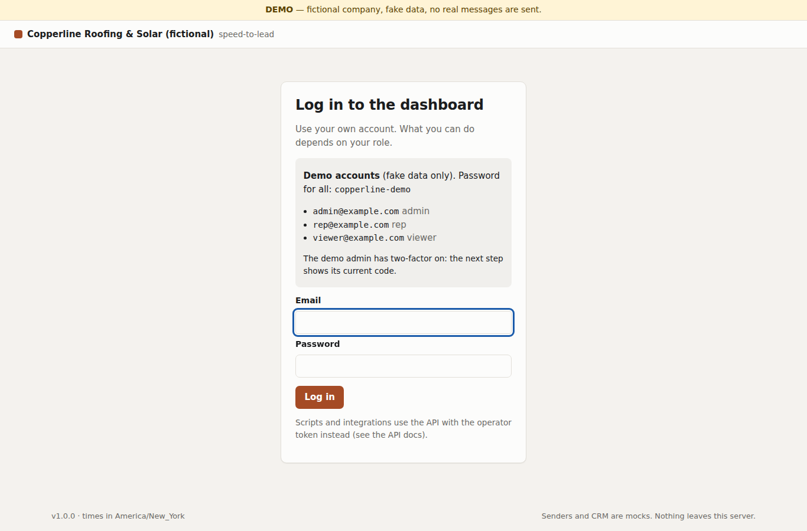
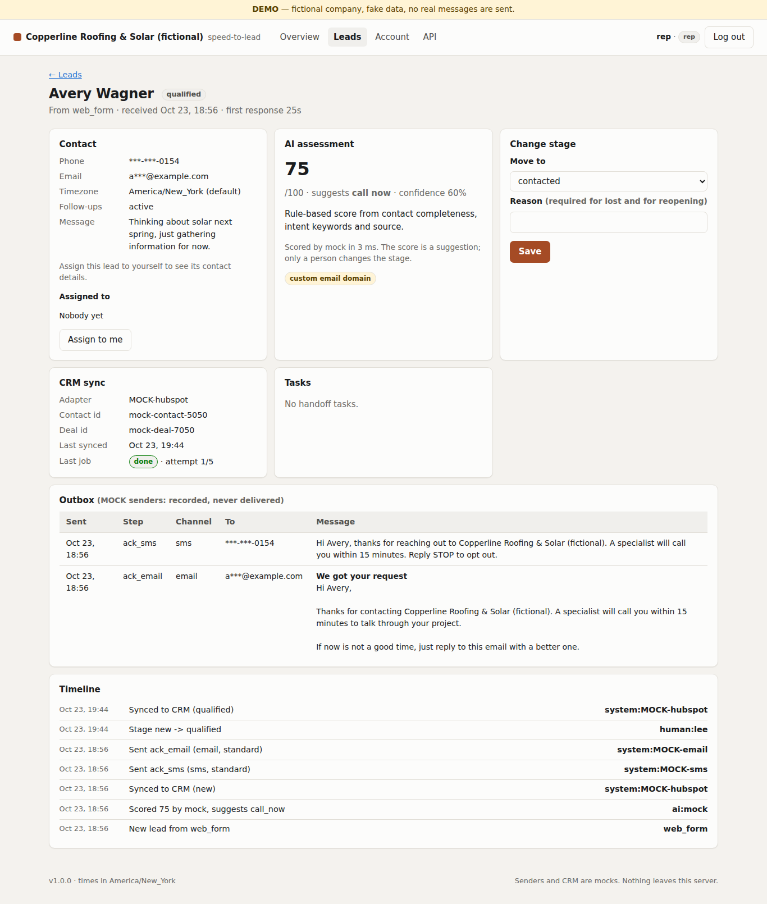
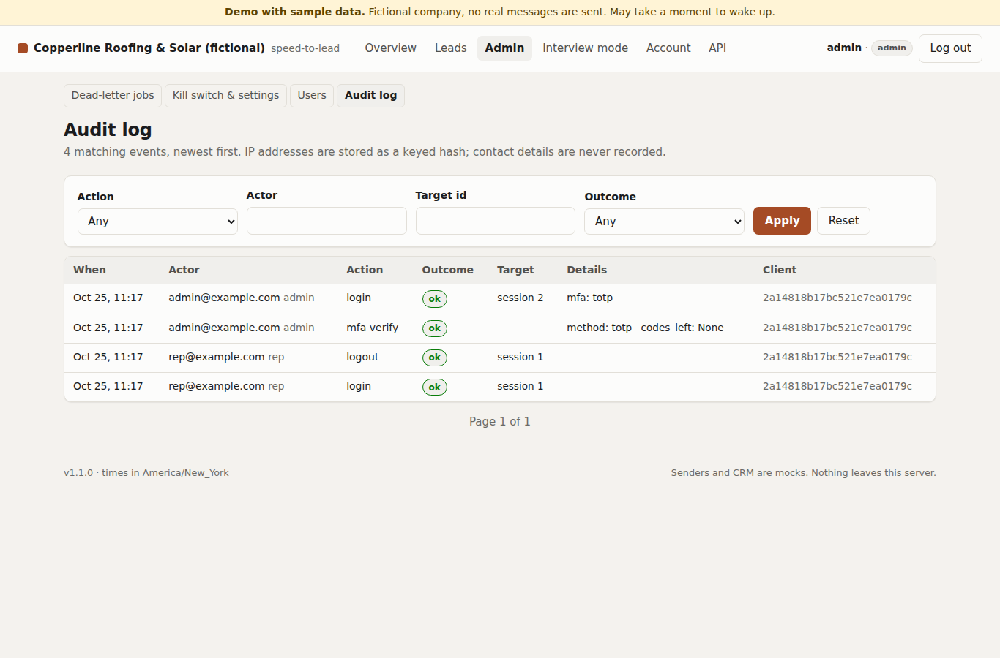
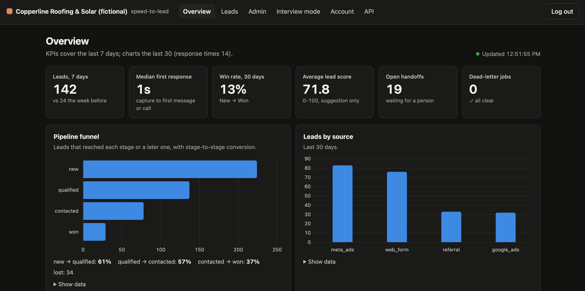
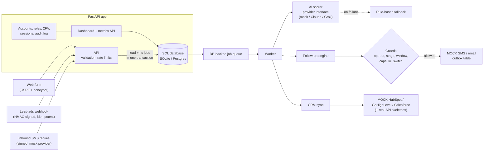

# speed-to-lead

**Reply to every new lead in seconds, safely: capture, verify, AI-score, follow up, and hand off to a person, with guardrails before every message.**

[](https://github.com/latin-guru/speed-to-lead/actions/workflows/ci.yml)
[](https://github.com/latin-guru/speed-to-lead/actions/workflows/security.yml)


This is a public showcase version of a lead pipeline I run in production. Business rules, prompts, and client data are kept private.

The demo business is **Copperline Roofing & Solar (fictional)**. All sample data is fake (`555-01xx` phone numbers, `example.com` emails), and **nothing is ever really sent**: the SMS and email senders and the CRM adapters used by default are mocks.



## Contents

- [The business problem](#the-business-problem)
- [Live demo](#live-demo)
- [Architecture](#architecture)
- [What it does (and the tests that prove it)](#what-it-does)
- [Tech stack](#tech-stack)
- [Security highlights](#security-highlights)
- [Run the demo locally](#run-the-demo-locally)
- [Run the tests](#run-the-tests)
- [Design decisions and tradeoffs](#design-decisions-and-tradeoffs)
- [Roadmap](#roadmap)
- [Contact](#contact) · [License](#license)

## The business problem

A lead who fills in a form or a lead ad is usually talking to several companies at once. The faster a lead hears back, the more likely they are to convert, and the first reply often decides who gets the conversation.

Doing that by hand breaks down quickly:

- **Slow first response.** Leads arrive at night, on weekends and while everyone is busy. Every minute of silence is a chance for a competitor.
- **Manual busywork.** Copying leads into a CRM, deciding who is worth a call, and sending the same "we got your request" message again and again.
- **Dropped follow-ups.** The second and third touch are where many deals are won, and they are the first things to slip.
- **Risky automation.** Naive automation texts people at 2 a.m., ignores STOP, double-sends on retries, or lets an AI model make decisions it should not make.

speed-to-lead answers within seconds, scores the lead, follows up on a polite schedule, and hands the conversation to a person the moment the lead replies, with every send checked against consent, time-of-day and frequency rules first.

## Live demo

<!-- TODO (main session): replace the placeholder below with the Render URL after the first deploy. -->
**https://&lt;render-app&gt;.onrender.com** (placeholder until the first deploy)

- Log in as **`viewer@example.com`** with the password **`copperline-demo`** (shown on the login page). The public demo offers only this read-only account: you can browse everything, contact details stay masked, and nothing can be changed.
- A new simulated lead arrives every few seconds through the real endpoints, and the dashboard refreshes on its own.
- It runs on a free instance that sleeps when idle, so the first visit can take **about 30-60 seconds** to wake up. Each restart reseeds fresh fake data.
- How it's hosted: one free Render web service defined in [`render.yaml`](render.yaml). The app, the job worker and the lead simulator run in that one process on a local SQLite file, so there's no paid worker, no expiring database and no cron. Demo mode refuses to start with a real AI provider, a real CRM or a non-SQLite database, and every sender is a mock.

| Login with the demo accounts | Lead detail (contact masked) | Audit log (admin) |
| --- | --- | --- |
|  |  |  |



## Architecture



- **Capture.** A server-rendered form and a JSON API accept leads; a lead-ads style webhook accepts them only with a valid HMAC signature. Input is validated and normalized (names, phone numbers, emails), and rate limits apply per client and per phone number.
- **Transactional outbox.** A new lead and all the work it needs (scoring, the first messages, CRM sync) are written in one database transaction, so the API answers in milliseconds and no lead can exist without its follow-up work.
- **Job queue and worker.** Jobs live in a database table. Workers claim them with a lease, retry with backoff, and move them to a dead-letter list after too many failures, where an admin can retry them.
- **AI scorer.** Behind a small provider interface (mock, Claude, Grok). Output must match a strict schema. Retries, a time budget and a circuit breaker protect the pipeline; any failure falls back to a rule-based score. The score is only a suggestion.
- **Follow-up engine.** Runs a short sequence (an instant acknowledgment, then reminders). Before every send it checks consent, the lead's stage, the sending window in the lead's time zone, frequency caps and a global kill switch. Any reply hands the lead to a person.
- **CRM sync.** Pushes each lead and stage change to a CRM through an adapter. Mocks are the default; the real-API skeletons show the request shapes.
- **Dashboard.** KPIs, a pipeline funnel, sources, score distribution and response times, refreshed every few seconds, plus lead pages with masked contact details, tasks and admin tools.
- **Auth and audit.** Email and password accounts with roles, two-factor for admins, server-side sessions, and an audit log of sensitive actions.

## What it does

Every row links to the tests that prove it. [`tests/test_readme_claims.py`](tests/test_readme_claims.py) parses this table and fails if a linked test file is missing, so the list cannot quietly drift from the code.

| Feature | Proof |
| --- | --- |
| Web form with CSRF token and honeypot; JSON lead API with strict validation and phone normalization | [`test_web_form.py`](tests/integration/test_web_form.py), [`test_leads_api.py`](tests/integration/test_leads_api.py), [`test_normalize.py`](tests/unit/test_normalize.py), [`test_schemas.py`](tests/unit/test_schemas.py) |
| Lead-ads style webhook: signature verified, fails closed without a secret, idempotent per lead id | [`test_webhook_meta.py`](tests/integration/test_webhook_meta.py), [`test_signatures.py`](tests/unit/test_signatures.py), [`test_meta_parse.py`](tests/unit/test_meta_parse.py) |
| Rate limits per client IP and a daily cap per phone number, with `Retry-After` | [`test_rate_limit.py`](tests/unit/test_rate_limit.py), [`test_leads_api.py`](tests/integration/test_leads_api.py) |
| DB-backed job queue: idempotent enqueue, leases, fencing, backoff, dead-letter and retry; concurrent workers never double-claim | [`test_queue.py`](tests/unit/test_queue.py), [`test_worker.py`](tests/integration/test_worker.py) |
| AI scoring with a strict output schema, one repair pass, retries, a circuit breaker and a rule-based fallback | [`test_ai_service.py`](tests/unit/test_ai_service.py), [`test_ai_resilience.py`](tests/unit/test_ai_resilience.py), [`test_ai_parsing.py`](tests/unit/test_ai_parsing.py), [`test_ai_schema.py`](tests/unit/test_ai_schema.py), [`test_ai_providers.py`](tests/unit/test_ai_providers.py) |
| Prompt-injection guards; suspicious input goes to human review, and the AI can never change a stage | [`test_ai_guard.py`](tests/unit/test_ai_guard.py), [`test_scoring_flow.py`](tests/integration/test_scoring_flow.py) |
| Pipeline with explicit allowed transitions; only a person moves a stage | [`test_pipeline_rules.py`](tests/unit/test_pipeline_rules.py), [`test_pipeline_api.py`](tests/integration/test_pipeline_api.py) |
| Follow-up sequence: instant acknowledgment, reminders, after-hours wording | [`test_followups.py`](tests/integration/test_followups.py), [`test_sequence.py`](tests/unit/test_sequence.py) |
| Guards before every send: sending window in the lead's time zone (DST-safe), weekly cap per person, minimum gap, kill switch | [`test_guards.py`](tests/unit/test_guards.py), [`test_followups.py`](tests/integration/test_followups.py) |
| STOP / START by SMS reply, and handoff to a person on any other reply | [`test_followups.py`](tests/integration/test_followups.py) |
| At-most-once sends, even when a job runs twice | [`test_followups.py`](tests/integration/test_followups.py), [`test_queue.py`](tests/unit/test_queue.py) |
| CRM sync to mock HubSpot, GoHighLevel and Salesforce; retries never create duplicate records | [`test_crm.py`](tests/unit/test_crm.py), [`test_crm_adapters.py`](tests/unit/test_crm_adapters.py) |
| Dashboard and metrics API: KPIs, funnel, sources, scores, response times, live refresh, masked contacts | [`test_dashboard.py`](tests/integration/test_dashboard.py), [`test_metrics.py`](tests/unit/test_metrics.py) |
| Accounts with argon2id, lockout, server-side sessions, roles enforced on every route (including other users' lead ids) | [`test_auth.py`](tests/integration/test_auth.py), [`test_authz.py`](tests/integration/test_authz.py), [`test_accounts.py`](tests/unit/test_accounts.py) |
| TOTP two-factor, required for admins, with single-use recovery codes | [`test_mfa.py`](tests/integration/test_mfa.py), [`test_totp.py`](tests/unit/test_totp.py) |
| Admin pages: dead-letter retries, kill switch, user management, audit log | [`test_admin_pages.py`](tests/integration/test_admin_pages.py) |
| Phone and email encrypted at rest, blind index for lookups, key rotation | [`test_fields.py`](tests/unit/test_fields.py) |
| Logs mask phone numbers and emails everywhere, including tracebacks | [`test_logging.py`](tests/unit/test_logging.py) |
| HTTP hardening: CSP without inline script, HSTS, CORS allowlist, body size limit, session-bound CSRF | [`test_http_security.py`](tests/integration/test_http_security.py), [`test_csrf.py`](tests/unit/test_csrf.py) |
| Outbound calls only to allowlisted HTTPS hosts (SSRF guard) | [`test_outbound.py`](tests/unit/test_outbound.py) |
| Data retention: anonymize or delete old leads | [`test_retention.py`](tests/integration/test_retention.py) |
| Migrations always match the models | [`test_migrations.py`](tests/integration/test_migrations.py) |
| Health and readiness checks | [`test_health.py`](tests/integration/test_health.py) |
| Demo mode: deterministic fake history and a lead simulator through the real endpoints | [`test_demo.py`](tests/integration/test_demo.py) |
| Public demo: viewer-only login, viewer cannot change anything, unsafe config refused, Render Blueprint checked | [`test_demo_hosting.py`](tests/integration/test_demo_hosting.py) |

## Tech stack

- **Backend:** Python 3.11 / 3.12, FastAPI, Pydantic v2, SQLAlchemy 2, Alembic, httpx
- **Data:** SQLite for the demo and tests, Postgres for production (Docker Compose included)
- **Frontend:** server-rendered Jinja templates, a little vanilla JavaScript, Chart.js (vendored, SRI-pinned)
- **Security:** argon2-cffi, cryptography (Fernet), pyotp, segno (QR codes)
- **Quality:** pytest, respx, ruff, mypy (strict), coverage floor of 95% in CI
- **CI and supply chain:** GitHub Actions pinned to commit SHAs, gitleaks, pip-audit, CodeQL, Dependabot
- **Hosting:** a Render Blueprint ([`render.yaml`](render.yaml)) for the one-service demo

## Security highlights

Built as if it held real people's contact details. The full threat model, with the file behind each protection, is in [SECURITY.md](SECURITY.md).

- Accounts with argon2id passwords, lockout with backoff, and TOTP two-factor required for admins.
- Roles checked on the server for every route, including object-level checks on each lead.
- Server-side sessions, session-bound CSRF tokens, strict CSP and other security headers.
- Phone and email encrypted at rest with a blind index; masked on screen and in logs; every reveal is audited.
- Signed, idempotent webhooks; outbound calls only to allowlisted hosts; prompt-injection guards on AI input.
- Demo mode refuses unsafe configuration: a non-SQLite database, a real AI provider without an explicit opt-in, or a non-mock CRM.

## Run the demo locally

```bash
git clone https://github.com/latin-guru/speed-to-lead.git && cd speed-to-lead
make install   # Python 3.11+ virtualenv with pinned dependencies
make demo      # http://127.0.0.1:8000/login
```

The demo resets a local SQLite file, seeds 30 days of fake history and starts the worker and the lead simulator in the same process. No API keys are needed. Locally all three demo accounts are offered (admin, rep and viewer, same password); the admin's two-factor step shows the current code, because the demo secret is public. Set `DEMO_ROLES=viewer` to get the public, read-only setup.

## Run the tests

```bash
make check     # ruff, ruff format --check, mypy --strict, pytest with a 95% coverage floor
```

The Postgres-specific queue test (`SKIP LOCKED`) runs when `TEST_POSTGRES_URL` points at a Postgres database; CI runs the suite on SQLite.

## Design decisions and tradeoffs

- **A database-backed queue instead of a message broker.** One fewer service to run, and jobs are created in the same transaction as the lead, so work is never lost or orphaned. Postgres claims rows with `SKIP LOCKED`; SQLite uses an atomic conditional update. The tradeoff is throughput: fine for lead volumes, not for millions of jobs per hour.
- **Idempotency keys everywhere.** Jobs, messages and CRM records each have a natural unique key, so retries and duplicate webhooks are harmless. This makes "at least once" execution safe without distributed transactions.
- **AI as a suggestion, with a rule fallback.** The model scores and suggests a next step; it cannot change a stage, send a message or call tools. If the provider is slow, down or returns bad output, a rule-based score takes over, so a lead is never stuck waiting on AI.
- **Guardrails before every send.** Consent, stage, time of day and frequency are checked at send time, not only when the message was scheduled, so a STOP or a human taking over always wins. "Not now" defers a job instead of dropping it.
- **Encryption plus a blind index.** Contact details are encrypted at rest, and a keyed hash allows exact-match lookups (duplicates, opt-outs) without decrypting. The tradeoff: no partial or fuzzy search on those fields.
- **Mocks for every external service.** Senders and CRMs are mocks with the same contracts as the real thing (including uniqueness rules), so the full flow runs and is tested offline. Real-API skeletons show the request shapes without shipping credentials.
- **Server-rendered dashboard.** Jinja plus a little JavaScript keeps the CSP strict (no inline script) and the attack surface small; polling instead of websockets keeps hosting simple.

## Roadmap

Not built yet:

- Real SMS and email senders (the repository only has mocks).
- Fetching full lead details from the ad platform's API (webhooks that carry only ids are recorded for a later fetch).
- A shared rate-limit store (Redis or the database) for running several web processes.
- Running the Postgres queue tests in CI.
- Self-service password reset by email, and passkeys (WebAuthn).
- Shipping audit events to tamper-evident external storage.
- OAuth token refresh for the Salesforce skeleton, and running the CRM skeletons against live sandboxes.

## Contact

Built by **Kevin Gaviria**. [Connect on LinkedIn](https://www.linkedin.com/in/kevin-gaviria)

## License

All rights reserved. This is a public showcase: you may read the code and run the demo locally to evaluate it. See [LICENSE](LICENSE). Vendored Chart.js keeps its own MIT license (`app/web/static/vendor/`).
