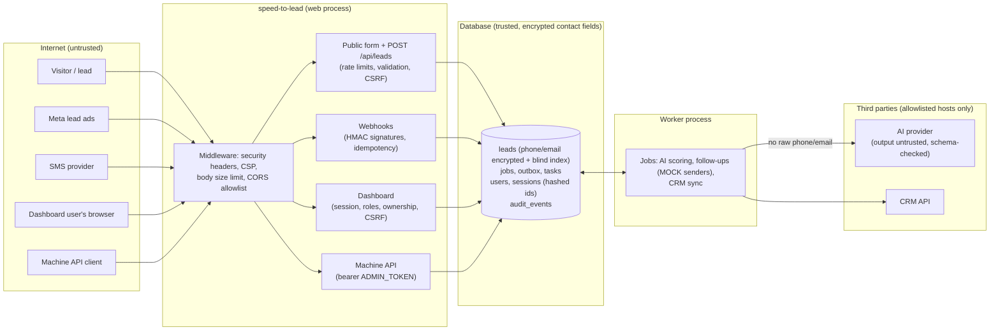

# Security

speed-to-lead is a portfolio project: a lead-response pipeline for a fictional company
(Copperline Roofing & Solar). It ships with mock senders and mock CRMs, and all sample
data is fake. It is still built as if it held real people's contact details, and this
document explains how.

- [Reporting a vulnerability](#reporting-a-vulnerability)
- [Threat model](#threat-model)
- [Protections, and where they live](#protections-and-where-they-live)
- [How production handles it (not included in this repo)](#how-production-handles-it-not-included-in-this-repo)
- [Known limitations](#known-limitations)
- [Roadmap](#roadmap)

Everything under "Protections" exists in this repository and names the code behind it.
Practices that only exist in a production deployment are listed separately and labeled.

## Reporting a vulnerability

Please report privately through GitHub: open the repository's **Security** tab and choose
**Report a vulnerability** (a private security advisory). Do not open a public issue for a
security problem.

Include what you found, how to reproduce it, and what an attacker could do with it. This
is maintained by one person on a best-effort basis: expect an acknowledgment within a
week. Fixes land on `main`; there are no maintained release branches.

## Threat model

### Assets

| Asset | Why it matters |
| --- | --- |
| Lead contact details (phone, email) and messages | Personal data. A leak harms the people who asked for an estimate. |
| The right to contact a lead | Sending to someone who opted out, or too often, is harassment and a compliance problem. |
| Dashboard accounts and sessions | They gate contact details, stage changes, user management and the kill switch. |
| Secrets: `SECRET_KEY`, `FIELD_ENCRYPTION_KEY`, `BLIND_INDEX_KEY`, `ADMIN_TOKEN`, webhook secrets, API keys | Each one unlocks a part of the system. <!-- pragma: allowlist secret --> |
| Pipeline integrity | Stages and the AI score drive what humans do next. |
| The audit log | The record of who saw or changed what. |

### Actors

| Actor | Trust |
| --- | --- |
| Anyone on the internet | Untrusted. Can submit the form and call `POST /api/leads`. |
| A lead | Untrusted. Their form text and SMS replies are data, never instructions. |
| Meta (lead ads) and the SMS provider | Trusted only when the request is signed with the shared secret. |
| AI provider (Claude or Grok) | Its output is untrusted: it is schema-checked and can only suggest. |
| Viewer | Read-only dashboard user. Never sees contact details. |
| Rep | Works leads. Sees contact details only for leads assigned to them. |
| Admin | Full dashboard access, including users and the kill switch. |
| Machine API client | Holds `ADMIN_TOKEN`; acts as an admin on the JSON API. |
| Operator with shell access | Runs migrations and `python -m app.cli`. Fully trusted. |
| Someone with a copy of the database | Should not get contact details or live sessions out of it. |

### Entry points

| Entry point | Who | Guarded by |
| --- | --- | --- |
| `GET/POST /` (lead form) | anyone | CSRF token, honeypot, IP rate limit, per-phone daily cap, strict validation |
| `POST /api/leads` | anyone | IP rate limit, per-phone daily cap, strict validation |
| `GET/POST /webhooks/meta` | Meta | verify token, HMAC-SHA256 signature, idempotency ledger, rate limit |
| `POST /webhooks/inbound/sms` | SMS provider | HMAC-SHA256 signature, idempotency ledger, 16 KB cap, rate limit |
| `/login`, `/login/2fa`, `/logout` | dashboard users | CSRF, Origin check, IP rate limit, account lockout, TOTP for admins |
| `/dashboard/**` | dashboard users | session, role permission, per-lead ownership, CSRF on every POST |
| `/admin/*`, `/api/leads/{id}`, `/api/tasks` | machine client | `Authorization: Bearer ADMIN_TOKEN` (fails closed if unset) |
| `/api/metrics/*` | dashboard users, machine client | session or bearer token; aggregates only, no contact details |
| `/docs`, `/openapi.json` | anyone (can be turned off) | read-only description of the API |
| `python -m app.cli`, `alembic` | operator | shell access |
| Outbound: AI provider, CRM | the worker | fixed, allowlisted hosts over HTTPS |

### Trust boundaries

## Protections, and where they live

### Accounts, sessions and access control

- **Passwords** are hashed with argon2id (argon2-cffi defaults: 64 MiB, 3 passes, random
  salt). Old hashes are upgraded on the next login. Passwords must be 12 to 128 characters
  and not the email. `app/security/passwords.py`
- **Login never says why it failed.** Unknown email, wrong password, locked or deactivated
  account all get the same message and status. An unknown email or locked account still
  runs a full hash verification, so timing does not reveal which emails exist.
  `app/services/users.py` (`authenticate`), `app/web/auth.py`
- **Lockout with backoff.** After 5 failures in a row an account locks for 60 seconds,
  doubling with each further failure up to an hour. While locked, the password is not even
  checked. Logins are also rate-limited per client IP. `app/services/users.py`
  (`LoginPolicy`), `app/api/deps.py` (`login_rate_limit`)
- **Two-factor (TOTP).** Required for admins (until they set it up, they can only reach
  their account page), optional for reps, not offered to read-only viewers. After a correct
  password the browser gets only a signed five-minute "password checked" cookie, scoped to
  `/login` and tied to the current password hash; the session is created after the code.
  Codes allow one step of clock drift, and each step works once per user (no replay). The
  enrollment QR code is drawn on the server and embedded as a `data:` URI, so the secret
  never reaches a third-party service; the secret is encrypted with the field-encryption
  key. Ten single-use recovery codes are shown once and stored as hashes. A wrong code
  counts toward the same lockout as a wrong password, and a correct password alone does
  not reset that count. An admin can reset another user's two-factor (lost phone), which
  ends that user's sessions. Enroll, verify, recovery use, regenerate, disable and reset
  are audited. `app/security/totp.py`, `app/services/mfa.py`, `app/web/auth.py`,
  `app/web/account.py`, `app/web/admin.py`. In demo mode the demo admin has two-factor on
  with a public secret and the code step shows its current code, so the real flow can be
  tried without an authenticator app; demo accounts cannot change it.
- **Server-side sessions.** The cookie holds a random id plus an HMAC; the database stores
  only a SHA-256 of the id. Sessions end after 12 hours (absolute) or 30 minutes idle. The
  dashboard's background refresh does not count as activity. Logging in always creates a
  new session (rotation) and ends the old one; logout, deactivation, a role change or a
  password reset ends sessions on the server. `app/security/sessions.py`
- **Cookies** are HttpOnly and SameSite=Strict, and Secure with the `__Host-` prefix
  everywhere except plain-HTTP localhost. `app/security/sessions.py`, `app/web/auth.py`
- **Roles, enforced on the server.** Every dashboard route declares the permission it
  needs, and every route that acts on one lead checks ownership too: a rep can change
  stages and close tasks on their own or unassigned leads, and reveal contact details only
  on leads assigned to them. Changing a lead id in the URL (IDOR) gets a 403, and the
  attempt is written to the audit log. Admins cannot change their own role, and the last
  admin cannot be removed. `app/security/authz.py`, `app/web/common.py` (`require`,
  `require_post`), `app/web/dashboard.py`, `app/web/admin.py`. Tests:
  `tests/integration/test_authz.py` checks every role against every sensitive action.
- **The machine API token** (`ADMIN_TOKEN`) is only accepted as a bearer token on the JSON
  API and is compared in constant time. A dashboard session is never accepted there (except
  on the aggregate metrics). If no token is set, those endpoints answer 503 instead of
  being open. `app/api/deps.py` (`require_admin`)

### Browser protections

- **CSRF:** every state-changing dashboard request needs a signed double-submit token that
  is bound to the session (a token from another session, or from before login, fails).
  POSTs that the browser marks as cross-site (`Sec-Fetch-Site`) or that carry a foreign
  or `null` Origin are refused, and SameSite=Strict cookies back this up.
  `app/security/csrf.py`, `app/web/common.py` (`csrf_ok`)
- **Security headers on every response**, including errors and static files: a strict
  Content-Security-Policy (`default-src 'none'`, scripts, styles, images and fetches from
  this origin only, no inline script or style, `frame-ancestors 'none'`,
  `form-action 'self'`), `X-Content-Type-Options: nosniff`, `X-Frame-Options: DENY`,
  `Referrer-Policy: same-origin`, a restrictive `Permissions-Policy`, COOP/CORP
  `same-origin`, `Cache-Control: no-store` outside `/static`, and HSTS on HTTPS.
  `app/security/headers.py`. All dashboard JavaScript is in static files and writes text
  with `textContent`; Chart.js is vendored and pinned with an SRI hash. A test fails if a
  template gains an inline script, style or event handler.
- **`/docs`** (Swagger UI) is the one page with a looser policy: it loads Swagger UI from
  a CDN and its single inline script gets a per-request nonce. Set
  `API_DOCS_ENABLED=false` to remove it. `app/main.py` (`_add_docs`)
- **CORS** is off unless exact origins are listed in `CORS_ALLOWED_ORIGINS`; wildcards are
  rejected and credentials are never allowed. `app/config.py`, `app/main.py`
- **Request size limit:** bodies over `MAX_REQUEST_BYTES` (64 KB) get 413, whether the size
  is declared or the body is streamed. `app/security/headers.py`
  (`BodySizeLimitMiddleware`)
- **No open redirects:** the login `next` parameter only goes back into `/dashboard`.
  `app/web/common.py` (`safe_next`)

### Personal data

- **Encrypted at rest:** lead phone numbers and emails, and the recipient of every
  outbox message, are encrypted with Fernet (AES-128-CBC + HMAC-SHA256, random IV) under
  `FIELD_ENCRYPTION_KEY`. The key setting is a list, so keys can be rotated:
  add a new key in front, run `python -m app.cli rotate-keys`, then remove the old one.
  `app/security/fields.py`, `app/models.py`, `app/cli.py`
- **Blind index for lookups:** an HMAC-SHA256 of the normalized phone or email (under a
  separate `BLIND_INDEX_KEY`) sits next to each encrypted value. The per-phone daily cap,
  STOP/START matching and the "one voice" frequency limits use it, so they work without
  decrypting anything. `app/security/fields.py`, `app/followups/guards.py`,
  `app/followups/engine.py`
- **Production refuses development keys:** with `ENVIRONMENT=prod`, `SECRET_KEY`,
  `FIELD_ENCRYPTION_KEY` and `BLIND_INDEX_KEY` must be set. Elsewhere a public development
  key is used and `/readyz` warns. Demo mode uses random per-process keys. `app/config.py`
- **Migration with backfill:** `migrations/versions/0003_encrypt_contacts.py` encrypts
  existing rows, builds the blind index and drops the plaintext columns (the downgrade
  decrypts back). A test runs it on rows written by the old schema.
- **Masked by default:** contact details (and any phone or email inside messages) are
  masked on every dashboard page. Revealing them is a POST that needs the permission on
  that lead, and it is written to the lead's timeline and the audit log. The revealed page
  is `no-store`.
- **Never logged:** a filter on the log handler masks phone numbers and emails in every
  log record, including `extra` fields and tracebacks. Error messages from CRM adapters
  carry status codes, never payloads. `app/logging.py`, `app/crm/http.py`
- **Minimal data to the AI:** the model never sees the raw phone or email, only whether
  they exist and the email domain. `app/services/scoring.py`
- **Retention:** `python -m app.cli retention` (schedule it daily) removes personal data
  from leads older than `RETENTION_DAYS` (365). The default `anonymize` mode keeps the row
  for metrics but clears name, contact details and their blind indexes, the message, free
  text in the timeline and tasks, and the outbox copies; `delete` mode removes the lead
  entirely. It also purges old login sessions. `app/services/retention.py`

### Audit log

`audit_events` records logins (success and failure), two-factor events, logouts, contact reveals, stage
changes, assignments, task closes, dead-letter retries, the kill switch, user changes,
retention runs, and refused attempts on other people's leads. Each event has the actor,
role, action, target, outcome, a scrubbed summary (masked and length-capped, never contact
details), a keyed hash of the client IP and the user agent. Events are written in the same
transaction as the action. Admins can filter them at `/dashboard/admin/audit`.
`app/services/audit.py`, `app/web/admin.py`

### Untrusted input and outbound calls

- **Validation:** names, phones (E.164), emails and messages are normalized and
  length-capped; Pydantic models forbid unknown fields. `app/schemas.py`,
  `app/services/normalize.py`
- **Webhooks** verify an HMAC-SHA256 signature over the raw body in constant time, fail
  closed when the secret is unset, and process each event id once.
  `app/security/signatures.py`, `app/api/webhooks.py`, `app/api/inbound.py`
- **Prompt injection:** lead text goes to the model as JSON inside a delimiter with a
  random nonce, no tools are offered, output must match a strict schema, suspicious input
  forces human review, and the scorer can never change a stage. `app/ai/`
- **SSRF:** every outbound URL comes from configuration, never from request data, and must
  be HTTPS to an allowlisted host (`api.anthropic.com`, `api.x.ai`, `api.hubapi.com`,
  `services.leadconnectorhq.com`, or a `*.my.salesforce.com` My Domain) with no
  credentials, path or custom port. It is checked when settings load and again when each
  client is built. Tests show that lead content cannot change the host and that no API
  input takes a URL. `app/security/outbound.py`
- **Sends are guarded:** opt-outs (STOP) apply to the number across leads, a sending
  window, per-person frequency caps and a kill switch run before every send, and each step
  is sent at most once. The senders in this repository are mocks. `app/followups/`

### Supply chain and CI

- Dependencies are pinned (`requirements*.txt`); Dependabot proposes weekly updates for pip
  and GitHub Actions.
- `.github/workflows/ci.yml`: ruff, ruff format, mypy (strict), and pytest on Python 3.11
  and 3.12 with a 95% coverage floor.
- `.github/workflows/security.yml`: gitleaks over the full history, pip-audit on the pinned
  requirements, and CodeQL (security-extended queries). Every action is pinned to a full
  commit SHA, workflows get read-only tokens by default, and superseded runs are cancelled.

## How production handles it (not included in this repo)

These are practices of the production deployment this showcase is based on. They are not
in this repository, so nothing here claims they are.

- **Backups:** the database is backed up encrypted, stored off the server, and restores
  are tested on a schedule.
- **Messaging compliance:** real SMS sending goes through a carrier-registered (A2P)
  sender with the provider's opt-out handling in addition to the app's own STOP rules, and
  only to people who asked to be contacted.
- **Secrets** live in the hosting platform's secret store, not in files, and are rotated
  when people or providers change.
- **TLS** is terminated by the platform in front of the app, which is what makes the
  Secure cookies and HSTS above meaningful.

## Known limitations

- **Rate limits are per process.** The token buckets live in memory. Several web
  processes need a shared store (Redis or the database) behind the same `BucketStore`
  interface.
- **Per-account lockout can be abused** to keep a known account locked (a deliberate
  trade-off against password guessing). The lock is short at first and an admin can unlock
  an account. In demo mode the lock is capped at 60 seconds because the demo accounts are
  public.
- **No self-service password reset.** Admins set passwords; there is no email flow.
- **Two-factor enrollment trusts the first login.** An admin without two-factor proves
  only their password before setting it up, so create admins with
  `python -m app.cli create-user` and have them enroll right away. TOTP is phishable in
  real time; passkeys would not be.
- **Not everything is encrypted.** Names, lead messages, SMS reply text in the timeline and
  task notes are stored in plaintext (masked on screen and in logs). Only phone and email
  (and outbox recipients) are encrypted.
- **The blind index allows equality checks.** Someone with the database and without the
  key cannot read values, but can see which leads share a phone or email. Rotating
  `BLIND_INDEX_KEY` means recomputing every index (a new migration); `rotate-keys` does
  not do it.
- **The audit log is not tamper-evident.** It is append-only by convention; a database
  administrator could change it.
- **IP hashes are keyed with `SECRET_KEY`.** If the key is unset (development) or changes,
  hashes from before and after cannot be compared.
- **Swagger UI on `/docs` loads from a CDN without subresource integrity.** Turn the docs
  off in production if that matters (`API_DOCS_ENABLED=false`).
- **SQLite does not enforce foreign keys by default.** The retention job deletes related
  rows itself; other cascades rely on the ORM. Use Postgres in production.
- **CRM skeletons are not production clients.** The Salesforce adapter expects an access
  token and does not refresh it; none of the skeletons have been run against a live
  account.
- **The demo accounts are public on purpose** and reseeded on every start. In demo mode
  user changes are turned off; for a public deployment, set `DEMO_ROLES=viewer` (the
  `render.yaml` Blueprint does). Demo mode refuses to start on a non-SQLite database, with
  a real AI provider unless `DEMO_ALLOW_REAL_AI=true`, and with a non-mock CRM
  (`app/config.py`, `tests/integration/test_demo_hosting.py`). The public lead form stays
  open in the hosted demo, so visitors can add fake leads; senders are mocks either way.
- **Behind a TLS-terminating proxy** (such as Render's) the app only learns the client
  address and HTTPS from the proxy's headers. Set `TRUST_FORWARDED_FOR=true` there (the
  Blueprint does): rate limits then key on the right-most `X-Forwarded-For` hop and HSTS
  follows `X-Forwarded-Proto`. Leave it off anywhere clients can reach the app directly.

## Roadmap

Planned, not built:

- Passkeys (WebAuthn) as a phishing-resistant second factor.
- Self-service password reset by email.
- Shipping audit events to tamper-evident external storage.
- A shared rate-limit store for running several web processes.
- OAuth token refresh for the Salesforce skeleton.
